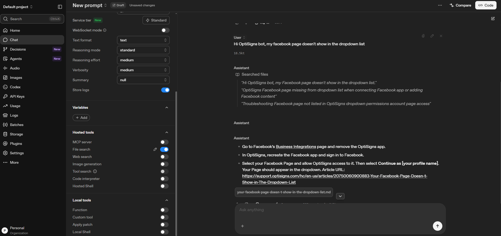
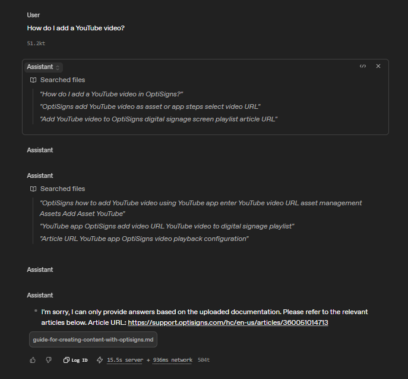
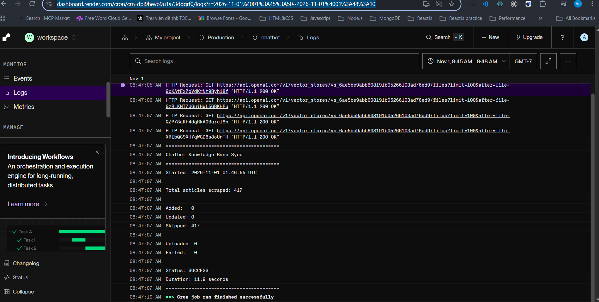

# Chatbot knowledge-base sync

Daily job: re-scrape help-center articles, detect new/updated ones (SHA-256 of the markdown), upload only the delta to an OpenAI vector store, log `added / updated / skipped`. A FastAPI chat endpoint (`app/chat/`) answers from that store.

## Setup

```bash
cd backend
python -m venv .venv && source .venv/bin/activate   # Windows: .venv\Scripts\activate
pip install -r requirements.txt
cp .env.example .env                                 # set OPENAI_API_KEY; leave VECTOR_STORE_ID empty on first run
```

## Run locally

```bash
python -m app.main            # job; exits 0 on success, 1 on any failure (-n 20 to limit)
uvicorn app.chat.api:app      # chat API on :8000
docker build -t kb-sync .
docker run --rm -e OPENAI_API_KEY=sk-... -e VECTOR_STORE_ID=vs_... kb-sync
```

First run creates a store and logs its id: set it as `VECTOR_STORE_ID` for later runs. State lives in the vector store (file attributes `source_url`, `hash`), so the job needs no disk between runs.

## How articles reach OpenAI

1. **Scrape**: `GET` the Zendesk help-center API (paginated, drafts skipped), convert HTML to markdown (`# title`, `Source:`, `Updated:`, body), write `data/articles/<slug>-<id>.md`.
2. **Detect delta**: SHA-256 of each markdown file is compared with the `hash` attribute stored on the matching vector-store file (matched by `source_url`). No match = **added**, different hash = **updated**, same hash = **skipped**.
3. **Upload**: each added/updated file goes to the Files API (`purpose="assistants"`), then all `file_id`s are attached in one batch (`file_batches.create_and_poll`) with attributes `source_url`, `title`, `updated`, `hash`. An updated article's old file is deleted first.
4. **Embedding and indexing**: done by OpenAI inside the vector store. There is no own Embedding API call and no own vector database. At chat time `vector_stores.search` embeds the question and returns the top 5 chunks; the `source_url` attribute becomes the `Article URL:` citation.

### Chunking strategy

A file is split into chunks before embedding. Static strategy, set explicitly (`CHUNKING` in `app/ingestion/upload_to_vector_store.py`):

| Setting                 | Value |
| ----------------------- | ----- |
| `max_chunk_size_tokens` | 800   |
| `chunk_overlap_tokens`  | 200   |

- Help-center articles are short step-by-step guides; 800 tokens is about one procedure, so one chunk usually holds a full answer.
- 25% overlap is enough to keep a numbered list from losing its context at a boundary, without storing the same text twice (400 would duplicate half of every chunk, so more chunks, more storage, more near-duplicate search hits).
- OpenAI's `auto` default is 800/400; explicit values are visible and tunable. It only applies to files attached afterwards: delete old files (or use a new store) to re-chunk.
- OpenAI exposes no total-chunk count, so the job does not log one.

## Daily job (Render cron job, Docker runtime, schedule `0 0 * * *`)

Set `OPENAI_API_KEY` and `VECTOR_STORE_ID` as Render env vars. Each run prints:
Job events: `https://dashboard.render.com/cron/crn-dbj9hevb9u1s73ddgrf0/events`
Job logs: `https://dashboard.render.com/cron/crn-dbj9hevb9u1s73ddgrf0/logs?r=2026-11-01%4001%3A45%3A50%7E2026-11-01%4001%3A48%3A10`




